<div align="center">


# Dangai

**Máquina de fazer shorts de recap de anime.**<br>
Você solta a narração, as prints e o roteiro. Ele devolve um MP4 9:16 pronto para publicar.

[](https://github.com/faahpla/dangai/releases/latest)
[](https://github.com/faahpla/dangai/releases/latest)
[](https://github.com/faahpla/dangai/releases)

[**Baixar**](#instalar) · [Recursos](#o-que-ele-faz) · [Gerar recap](#gerar-recap) · [Desenvolver](#desenvolver)

<br>


<sub>Trecho de um short renderizado pelo Dangai.</sub>

</div>

---

Não é um editor de vídeo. É um caminho só, do material bruto ao arquivo final,
com ajuste manual onde importa.

<p align="center">
  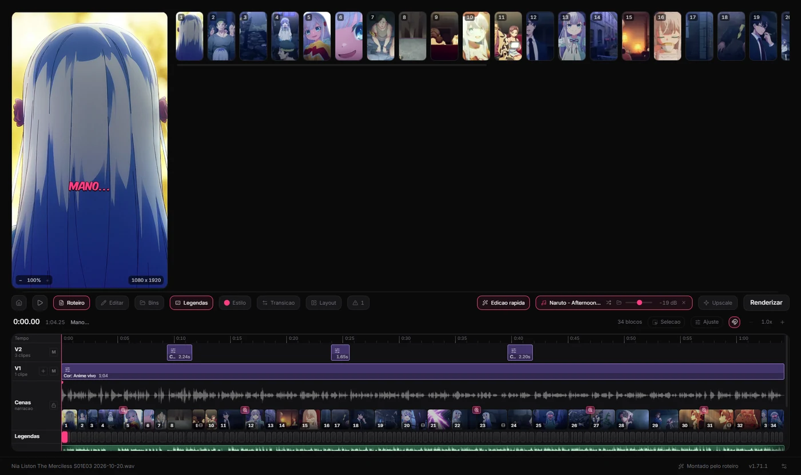
</p>

## O que ele faz

<table>
<tr>
<td width="50%" valign="top">

**Transcrição local**<br>
Whisper na sua máquina (base, small ou medium). O áudio não vai para lugar nenhum.

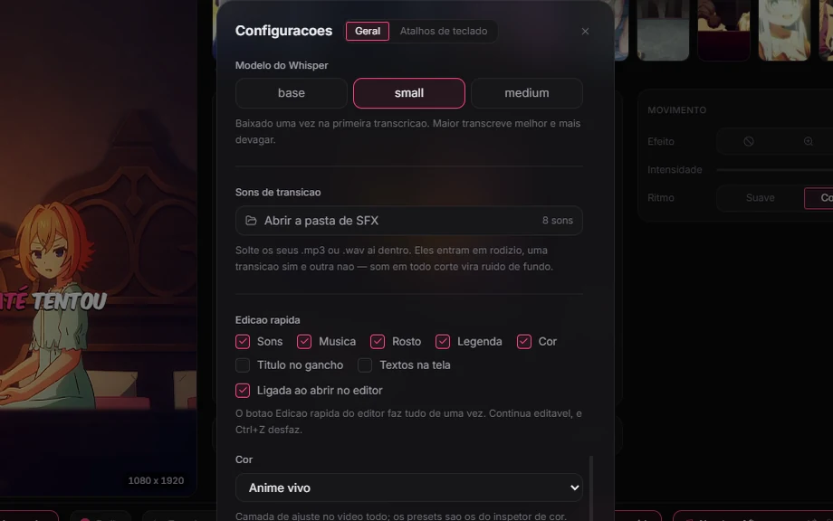

</td>
<td width="50%" valign="top">

**Legenda pelo roteiro**<br>
O texto vem do roteiro, sem erro de escrita. Os tempos vêm da narração.

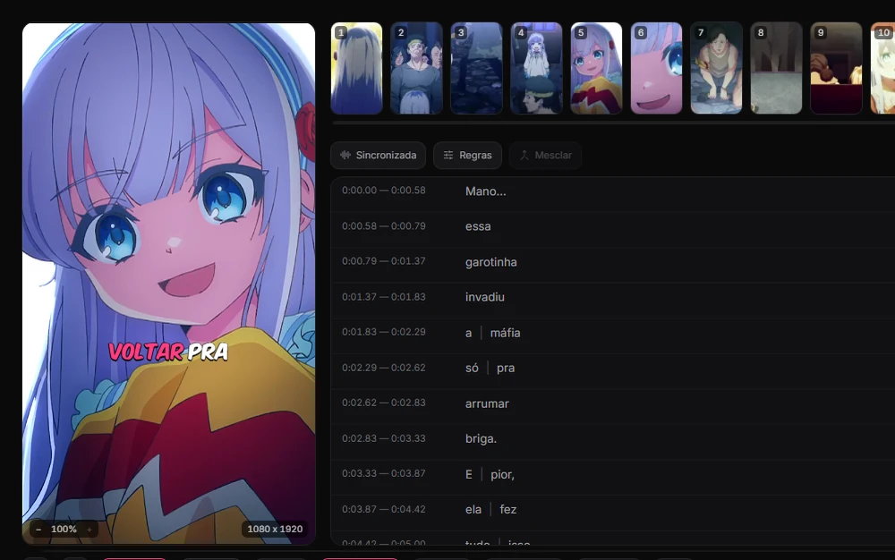

</td>
</tr>
<tr>
<td valign="top">

**Cenas pela pontuação**<br>
Um ponto final fecha uma ideia. É ali que o olho aceita outra imagem.

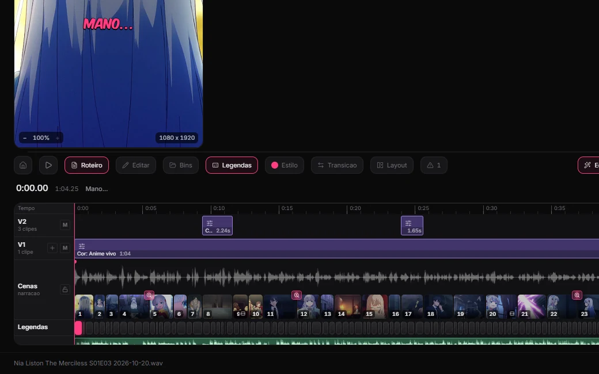

</td>
<td valign="top">

**Ken Burns e transições**<br>
Zoom, pan e ritmo em cada imagem, transição entre as cenas e enquadramento por clipe.

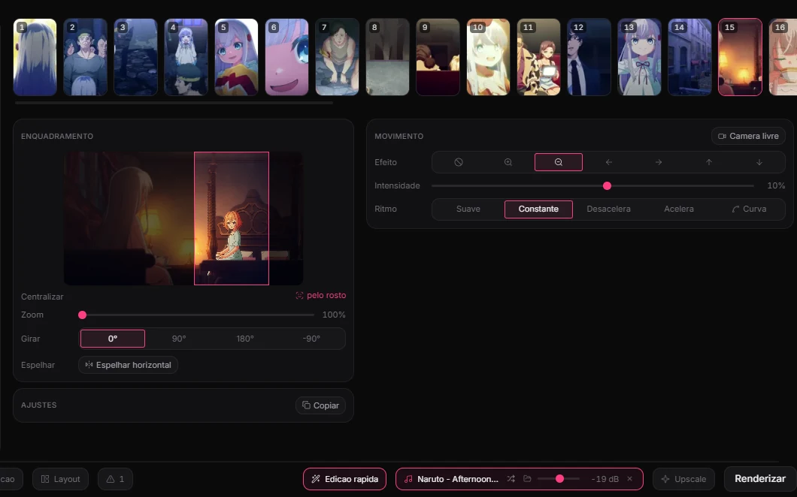

</td>
</tr>
<tr>
<td valign="top">

**SFX**<br>
Seus .mp3 e .wav entram em rodízio nas transições. Dá para pôr mais na mão, em faixas próprias.

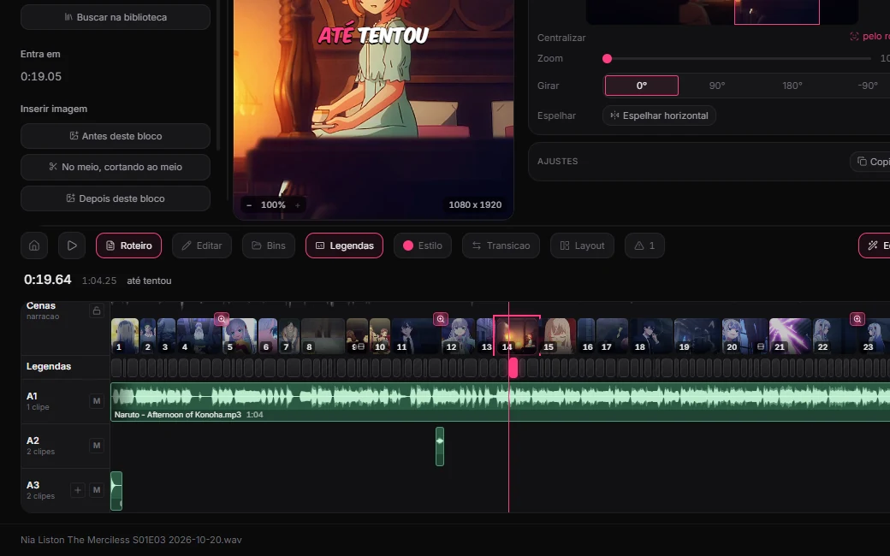

</td>
<td valign="top">

**Render 1080x1920 a −14 LUFS**<br>
23.976 fps, H.264, legendas queimadas em Komika Axis e áudio normalizado.

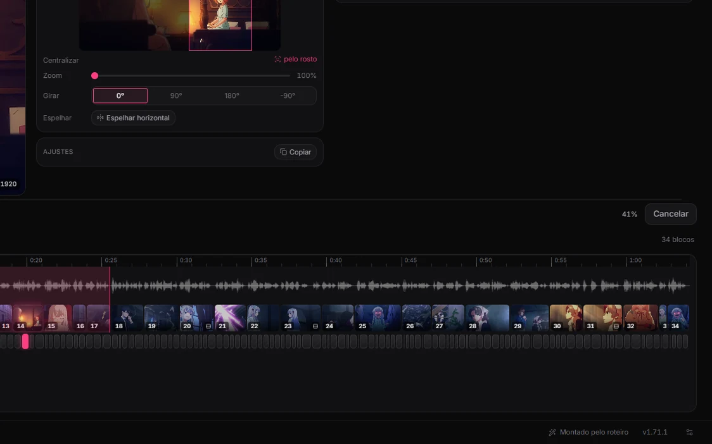

</td>
</tr>
<tr>
<td valign="top">

**Biblioteca de cenas**<br>
Os episódios cortados em cenas, com busca por fala, anime ou personagem.

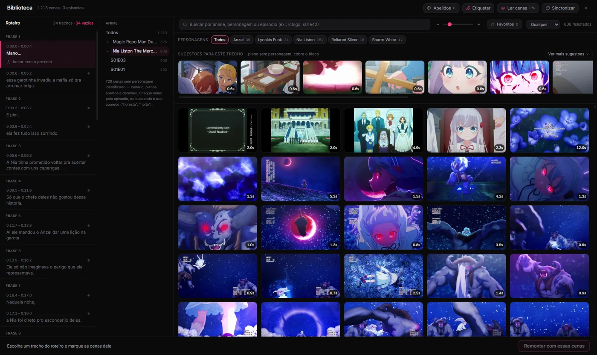

</td>
<td valign="top">

**Upscale e legendar vídeo pronto**<br>
Para um MP4 que já existe, direto da tela inicial, fora de qualquer projeto.

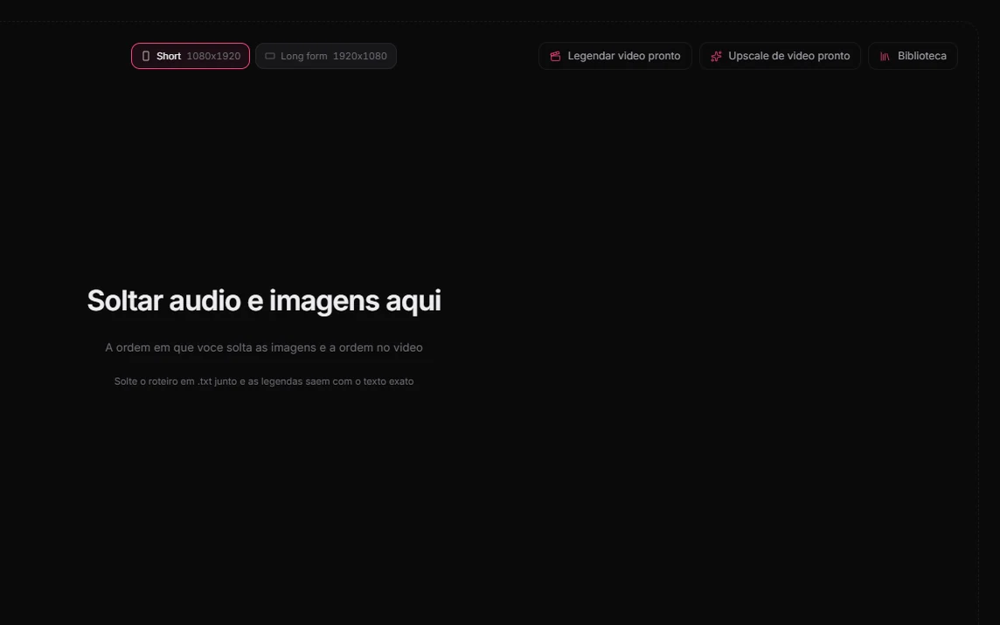

</td>
</tr>
</table>

Com uma chave de IA configurada (Gemini, grátis, ou Anthropic), a distribuição das cenas passa a ser decidida
pelo conteúdo da narração. Sem chave, tudo continua funcionando, só com os
cortes pela pontuação.

## Gerar recap

Um módulo que leva **do episódio ao vídeo pronto**. Vem desligado. Para ligar:
**Configurações > Módulos**.

| | Etapa | O que acontece |
| :-: | --- | --- |
| 1 | **Episódio** | Corta o episódio em cenas e reconhece os personagens. |
| 2 | **Roteiro** | Escreve com o Gemini (plano grátis serve), no seu estilo, e um revisor confere. |
| 3 | **Voz** | Narração pelo ElevenLabs ou pelo Fish, ou importe a sua. |
| 4 | **Cenas** | Sugere as cenas de cada frase. Dá para montar grid ou escolher a cena na mão. |
| 5 | **Editor** | Abre no editor do Dangai, com a Edição rápida já aplicada. |
| 6 | **Vídeo pronto** | Depois do render: títulos, texto da thumb, descrição e hashtags. |

<details open>
<summary><b>Passo a passo com imagens</b></summary>

<br>

**1. Episódio.** Solte o `.mkv`. Ele corta em cenas, lê a legenda e reconhece os
personagens. Abertura e encerramento ficam fora do recap.

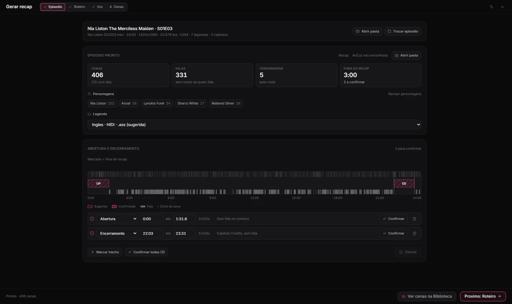

**2. Roteiro.** O Gemini escreve no estilo que você ensinou, com regras fixas de
segurança do YouTube e do TikTok. Um revisor aponta o que melhorar.

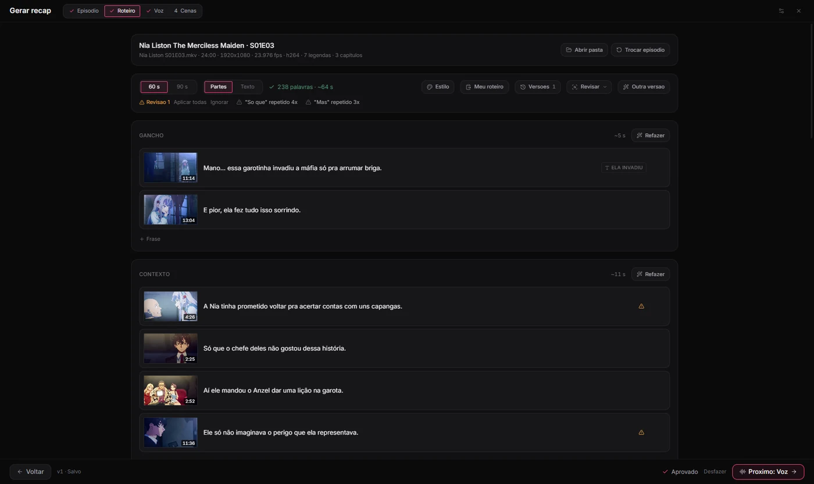

**3. Voz.** ElevenLabs, Fish ou um áudio seu. Antes de gerar, ele mostra quantos
caracteres vai gastar.

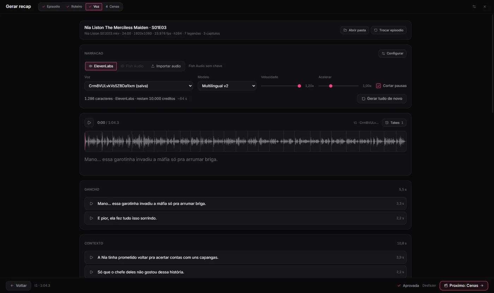

**4. Cenas.** Sugestões para cada frase, perto do momento certo do episódio. Grid
de duas cenas, ou a cena escolhida na mão.

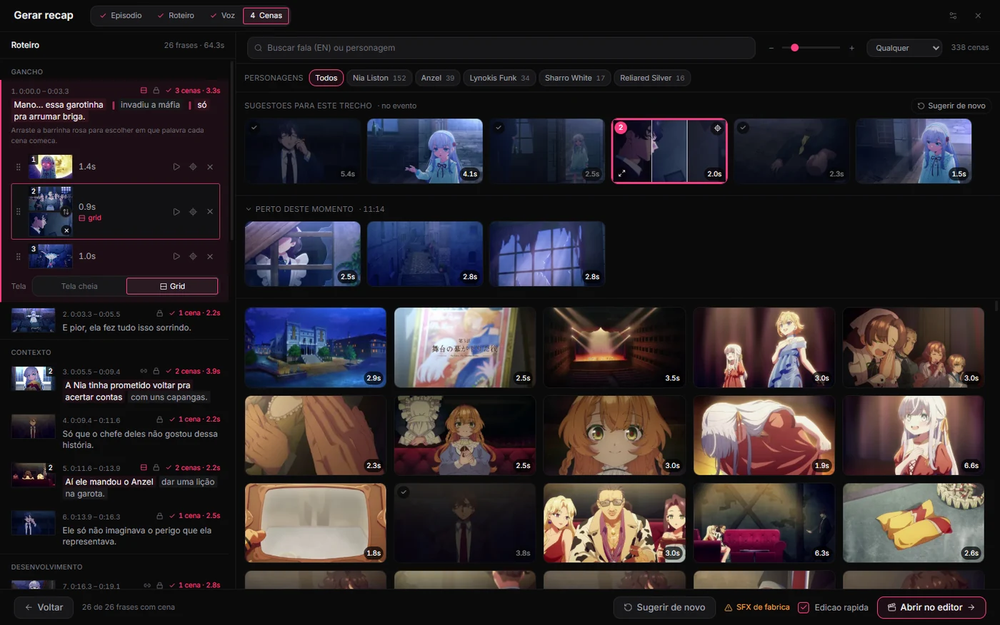

**5. Editor.** O projeto abre montado, com a Edição rápida: sons, música, recorte
no rosto, legenda e cor de uma vez. Tudo continua editável, e Ctrl+Z desfaz.

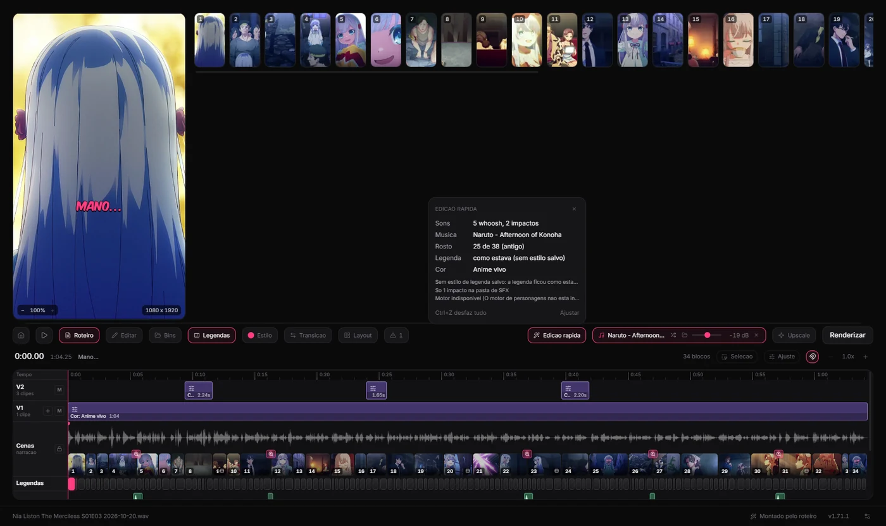

**6. Vídeo pronto.** Assim que o render termina: o vídeo, títulos, texto da thumb,
descrição e hashtags para copiar.

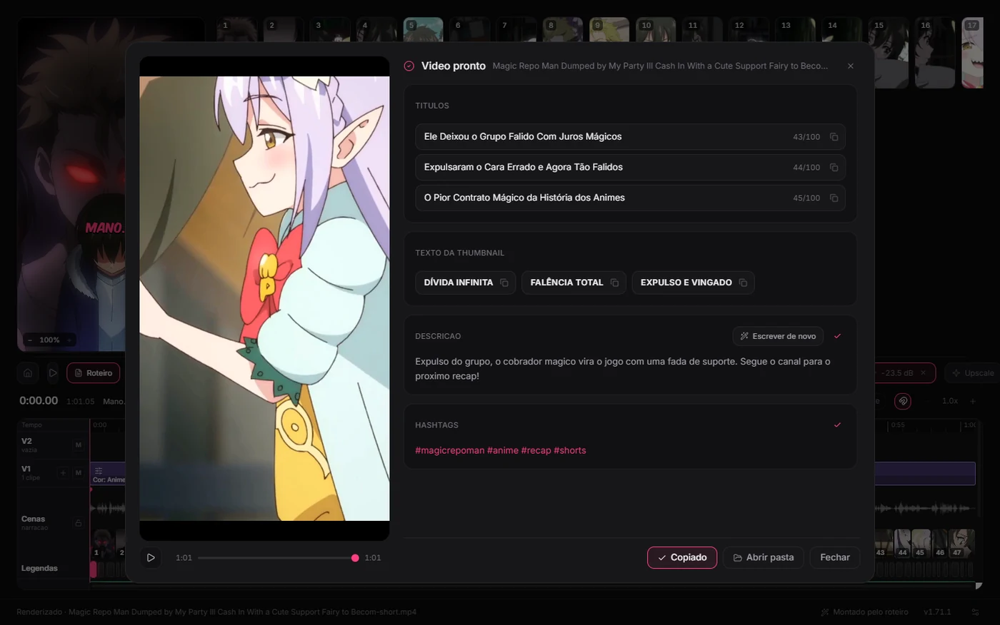

</details>

## Instalar

Baixe o instalador mais recente em
[**Releases**](https://github.com/faahpla/dangai/releases/latest).

> [!NOTE]
> O instalador não é assinado. Na primeira execução o SmartScreen avisa:
> clique em **Mais informações → Executar assim mesmo**.

## Atualizar

O app se atualiza sozinho:

1. consulta as releases;
2. baixa a versão nova em segundo plano;
3. mostra um botão na barra de status quando ela está pronta.

Reiniciar é decisão sua.

## Desenvolver

```bash
npm install
npm run dev
```

| Comando | O que faz |
| --- | --- |
| `npm run dev` | abre o app com recarga automática |
| `npm run typecheck` | TypeScript nos três processos |
| `npm run build` | typecheck + bundles do Electron e do Remotion |
| `npm run dist` | gera o instalador em `release/` |
| `npm run icon -- caminho/logo.png` | regenera `build/icon.ico` |
| `npm run sfx` | sintetiza os SFX de exemplo |

### Onde as coisas ficam

```
electron/     processo main: whisper, ffmpeg, render, arquivos
shared/       o que main e renderer precisam concordar (planos, legendas, alinhamento)
src/          interface React
src/remotion/ a composição do vídeo, a mesma no preview e no render
modulos/      módulos opcionais (modulos/recap/ é o Gerar recap)
```

`shared/` existe porque o preview e o render precisam chegar exatamente ao mesmo
plano. Se divergirem, o preview mente.

Dados do usuário ficam em `%APPDATA%/dangai`: chave da API, modelo do Whisper,
pasta de SFX e o Chrome do render.

## Publicar uma versão

```bash
npm version minor        # patch, se for só correção
git push
git push origin vX.Y.Z
npm run release
```

> [!IMPORTANT]
> **O push vem ANTES do release**, e o script recusa publicar sem isso.
> A tag vai num push próprio porque `--follow-tags` só envia tags **anotadas**,
> e as deste projeto são leves. `git push --follow-tags` a deixaria para trás sem
> reclamar.

`npm run release` empacota e publica pelo `gh`. Precisa do `gh` autenticado.
Para ensaiar sem publicar:

```bash
npm run release -- --dry-run
```

Ele confere sozinho, e recusa em vez de publicar errado:

| Recusa quando | |
| --- | --- |
| tree sujo | há mudança sem commit |
| tag fora do remoto | ou apontando para outro commit |
| `latest.yml` de outra versão | sobra de uma publicação anterior |
| tamanho do `.exe` | diferente do que o `latest.yml` declara |

No fim pergunta ao endpoint `releases/latest` o que o **updater** vê, e não o que
está na tag. Os apps instalados percebem sozinhos em algumas horas, ou na
próxima abertura.

<details>
<summary><b>Por que não é <code>electron-builder --publish always</code></b></summary>

<br>

Porque isso falhou três vezes seguidas, e não por configuração. O
electron-builder abre **um publisher por artefato**, cada um com a release
cacheada numa instância própria. Com o `.exe` e o `.blockmap` são duas chamadas
concorrentes que leem "a release não existe" e criam as duas. Uma ganha, a outra
recebe `422 already_exists` e **aborta o processo**, levando junto o
`latest.yml`, que só seria gerado depois.

Foi assim que a v1.24.0 saiu com duas releases na mesma tag (o GitHub elegeu
como "latest" a que estava quase vazia) e a v1.25.0 saiu sem `latest.yml`.

</details>

> [!WARNING]
> **`release/` não é limpo entre publicações.** O `latest.yml` da versão anterior
> sobrevive ali com cara de novo. Subi-lo produz uma release completa na
> aparência que diz aos apps que a versão mais recente é a velha: ninguém
> atualiza, e o sintoma aparece dias depois. O script faz essa conferência antes
> de qualquer upload.

## Privacidade

Nenhum arquivo sai da sua máquina. O áudio é transcrito localmente e as imagens
nunca são enviadas. Quando a IA está ligada, só o texto da transcrição vai para
a API, mais nada.

<sub>O módulo Gerar recap, quando ligado, manda o que cada etapa precisa para os
serviços que você escolher (Gemini, ElevenLabs, Fish), cada um com a sua chave.</sub>
